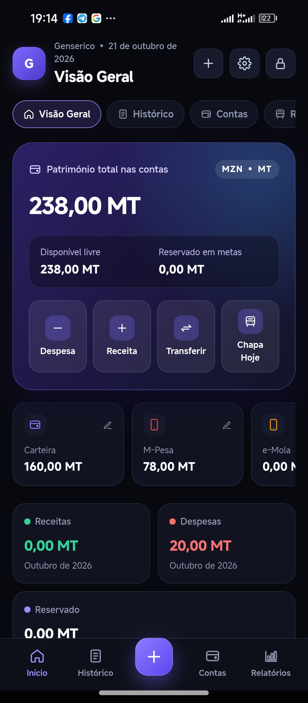
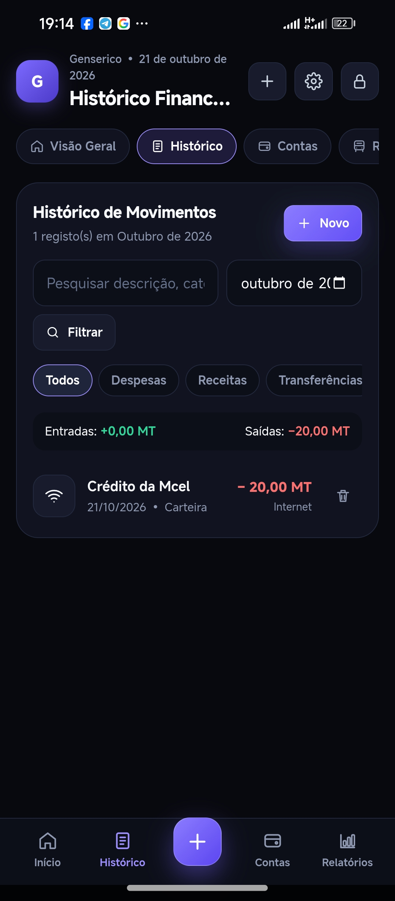
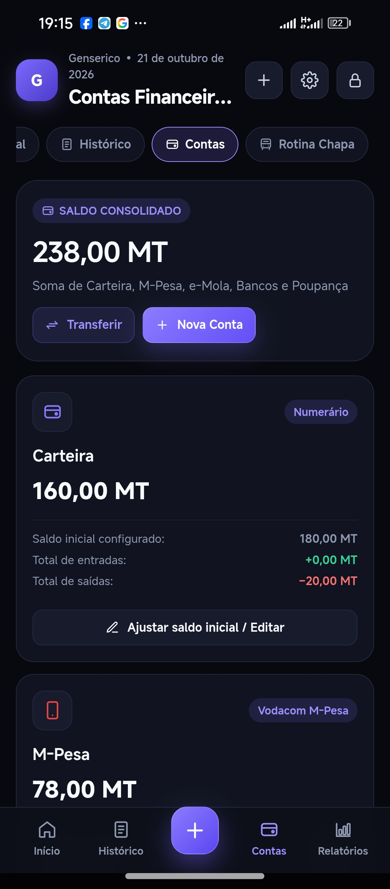
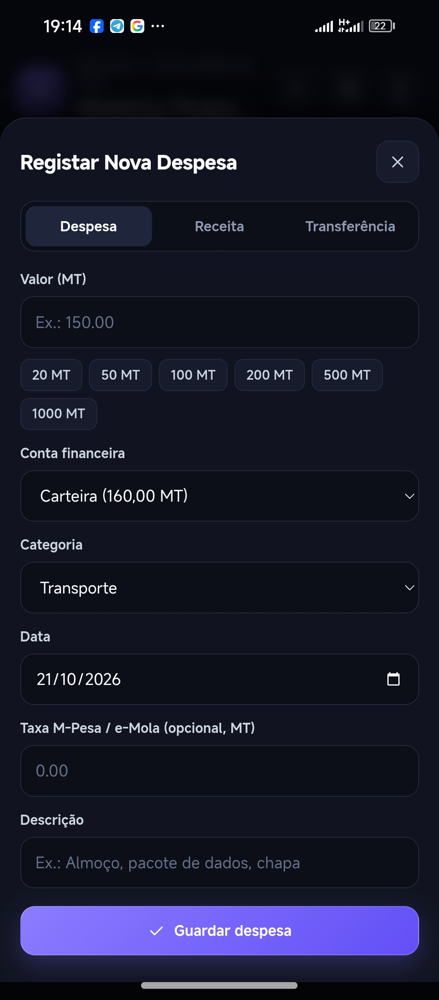
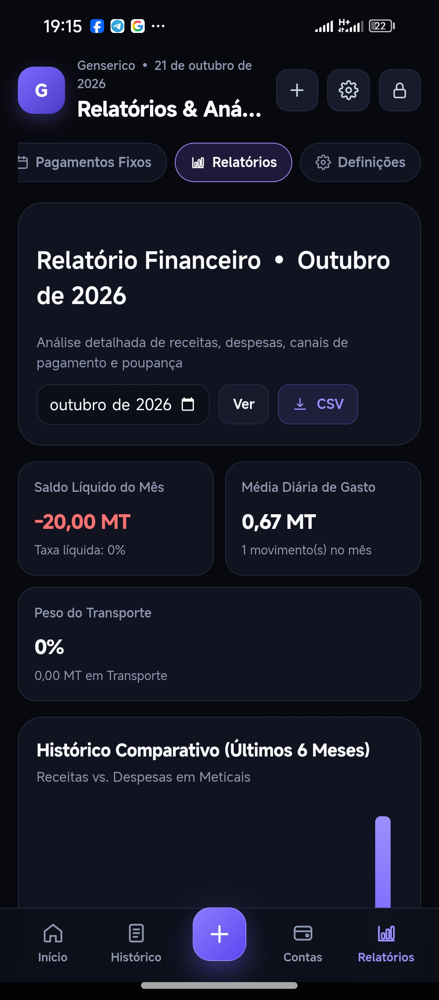
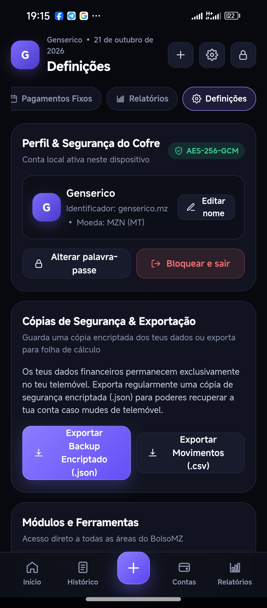

# BolsoMZ — Finanças pessoais para Moçambique

Contas, receitas, despesas, transferências, chapa, orçamentos e poupança em Meticais. Aplicação concebida para uso pessoal por diferentes utilizadores, com funcionamento local sem internet.

**Estado em 21/10/2026:** versão Android v2 recebida e arquivada com código, APK e fotografias do telefone. Integração bancária automática, câmbio online, notificações nativas, sincronização e aplicação iOS **ainda são requisitos de evolução**. O produto não está validado para lançamento público.

## Começar

- [APK recebido e informações de instalação](releases/v2.0.0/README.md)
- [Código Android v2 recebido, preservado sem alterações](imports/android-v2.0.0/)
- [Galeria: 18 capturas reais do telefone](docs/screenshots/README.md)
- [Funcionalidades e limitações verificadas](docs/ESTADO_ATUAL.md)
- [Requisitos, arquitetura e critérios de aceitação](docs/REQUISITOS_EVOLUCAO.md)
- [Prioridades e plano de evolução](docs/ROADMAP.md)
- [Prompt completo para o Gemini Argon](docs/PROMPT_GEMINI_ARGON.md)
- [Resultados da verificação de 21/10/2026](docs/VALIDACAO_2026-10-21.md)

## Interfaces no telefone

As imagens foram enviadas pelo utilizador. Os nomes, valores e movimentos visíveis pertencem às capturas recebidas; não são resultados de uma nova sessão de testes.

<table>
<tr>
<td align="center"><strong>Visão geral</strong><br></td>
<td align="center"><strong>Histórico</strong><br></td>
<td align="center"><strong>Contas</strong><br></td>
</tr>
<tr>
<td align="center"><strong>Nova despesa</strong><br></td>
<td align="center"><strong>Relatórios</strong><br></td>
<td align="center"><strong>Definições</strong><br></td>
</tr>
</table>

[Ver as 18 capturas e os originais](docs/screenshots/README.md). A [composição visual recebida](docs/design/Code_Generated_Image.png) é uma referência gerada, distinta das fotografias do telefone.

## Funcionalidades da v2 recebida

| Área | Comportamento existente | Limite atual |
| --- | --- | --- |
| Cofre pessoal | Registo e login locais; PBKDF2-SHA256 e AES-256-GCM | Sem identidade remota ou recuperação por servidor |
| Contas | Carteira, M-Pesa, e-Mola, conta bancária genérica e poupança; contas adicionais | Movimentos e saldos introduzidos pelo utilizador |
| Movimentos | Receitas, despesas, transferências, taxas opcionais e histórico | Sem leitura automática de bancos; sem idempotência de importação |
| Saldo | Cálculo em centavos por conta e total consolidado | Exatidão externa depende de movimentos completos e reconciliação |
| Dia a dia | Rotina de chapa, metas, orçamentos e pagamentos fixos | Regras locais; alertas nativos por implementar |
| Relatórios | Receitas/despesas, categorias, canais e exportação CSV | Sem cotações cambiais ou várias moedas |
| Cópias | Exportação/restauro de backup cifrado | Migração entre os dois projetos Android por validar |
| Plataforma | Android com recursos web empacotados; interface escura responsiva | Sem projeto iOS; compatibilidade real exige matriz de testes |

## Duas linhas de código preservadas

| Local | Conteúdo | Situação |
| --- | --- | --- |
| Raiz e `android/` | Linha 1.1 beta existente no GitHub, com `NativeVaultBridge.java` | Continua a ser a entrada dos workflows existentes |
| `imports/android-v2.0.0/` | Projeto Kotlin Gradle/Java e interface v2 do ZIP recebido | Snapshot fiel, ainda não fundido com a linha da raiz |
| `releases/v2.0.0/` | APK e ZIPs originais, hashes e metadados | Binário fornecido; não recompilado nesta atualização |

Esta organização permite comparar a persistência nativa anterior com o cofre IndexedDB da v2 antes de escolher a base de integração. A versão do APK, a assinatura e os identificadores de aplicação divergem: consultar [o registo de validação](docs/VALIDACAO_2026-10-21.md).

## Executar e verificar a linha da raiz

Requer Node.js 22 ou compatível. A sincronização dos recursos Android antecede os testes de empacotamento:

```bash
npm run android:sync
npm test
npm start
```

Auditar os requisitos de integridade ainda não satisfeitos pela v2:

```bash
node scripts/audit-imported-v2.mjs
```

A auditoria devolve código 1 enquanto existirem requisitos não satisfeitos; não é um novo teste obrigatório do workflow da linha 1.1. Os resultados têm âmbito documentado e não equivalem a testes de Android/iOS reais.

## Próximas entregas

1. Confirmar gravações duráveis, migrações e assinatura de atualização; consolidar o motor financeiro com operações atómicas, reconciliação e proteção contra duplicações.
2. Implementar escolha de banco e número de conta opcional protegido: Millennium bim, BCI, Letshego e catálogo atualizável de outras instituições moçambicanas.
3. Implementar câmbio MZN com fonte, momento da cotação, compra/venda quando disponíveis e cache offline identificada.
4. Acrescentar notificações nativas de saldo e vencimentos, com permissão e privacidade no ecrã bloqueado.
5. Validar Android 14 e posteriores e criar aplicação iOS com suporte planeado desde iPhone 7/iOS 15.
6. Evoluir para sincronização opcional e isolamento entre utilizadores com testes e métricas de capacidade.

Consultar [segurança](SECURITY.md), [bancos e fontes](docs/BANCOS_MOCAMBIQUE.md) e [compatibilidade](docs/COMPATIBILIDADE.md).
