# Interfaces enviadas pelo utilizador

18 capturas originais do telefone, recebidas em 21/10/2026. Os ficheiros JPG foram copiados sem alterações de imagem; somente os nomes usados na documentação foram normalizados. A correspondência com os nomes originais e os hashes está em [index.json](index.json).

Os saldos, perfis e movimentos visíveis são os das capturas enviadas. Não comprovam integração com um banco, reconciliação do saldo nem testes em outros aparelhos. O repositório mantém a sua visibilidade privada.

[Descarregar o ZIP original](Fts-do-bolsoMz-originais.zip) · [Composição visual recebida, referência distinta das capturas reais](../design/Code_Generated_Image.png)

## 01. Onboarding inicial

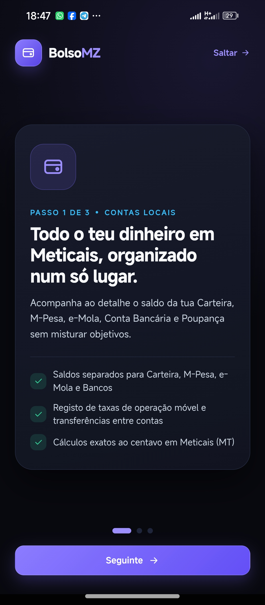

[Abrir imagem original](01-onboarding-inicial.jpg)

## 02. Dashboard — saldo inicial

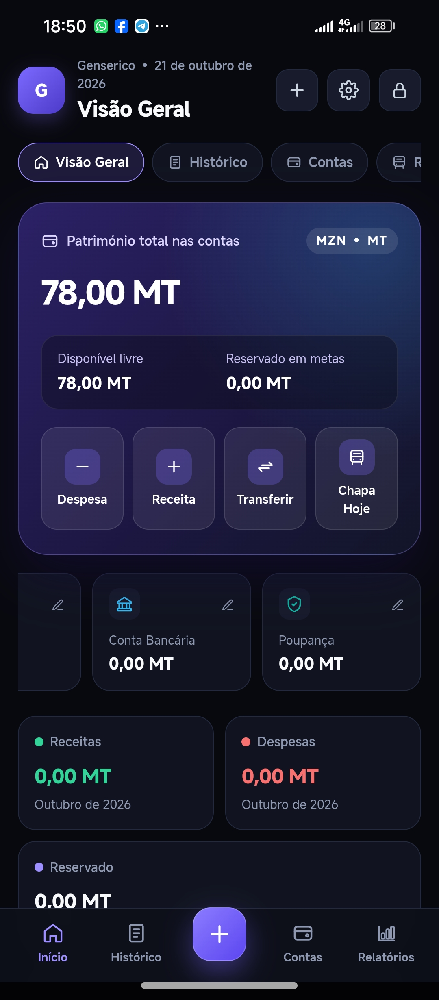

[Abrir imagem original](02-dashboard-saldo-inicial.jpg)

## 03. Criar cofre

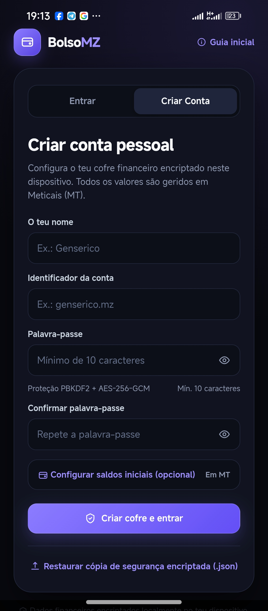

[Abrir imagem original](03-registo.jpg)

## 04. Desbloquear cofre

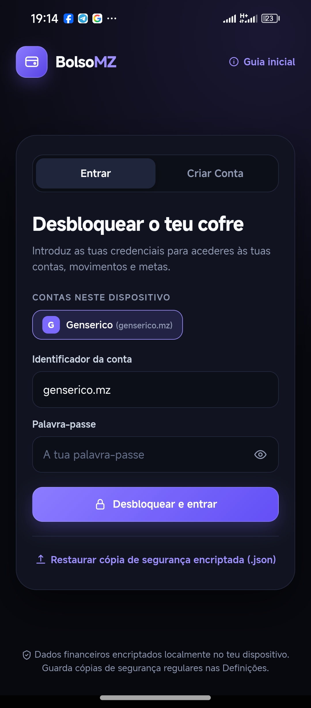

[Abrir imagem original](04-login.jpg)

## 05. Onboarding — contas

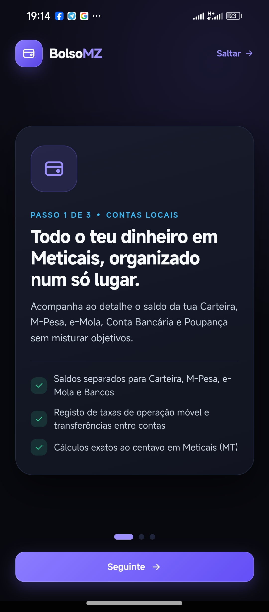

[Abrir imagem original](05-onboarding-contas.jpg)

## 06. Onboarding — chapa e metas

[Abrir imagem original](06-onboarding-chapa.jpg)

## 07. Onboarding — privacidade

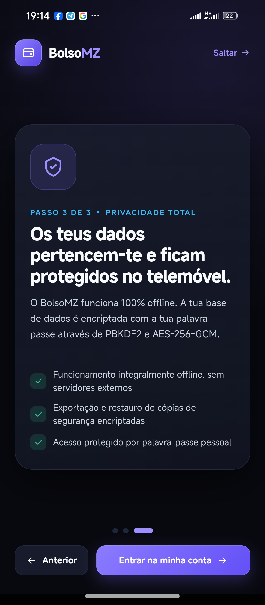

[Abrir imagem original](07-onboarding-privacidade.jpg)

## 08. Dashboard — movimentos registados

[Abrir imagem original](08-dashboard.jpg)

## 09. Histórico de movimentos

[Abrir imagem original](09-historico.jpg)

## 10. Nova despesa

[Abrir imagem original](10-nova-despesa.jpg)

## 11. Nova receita

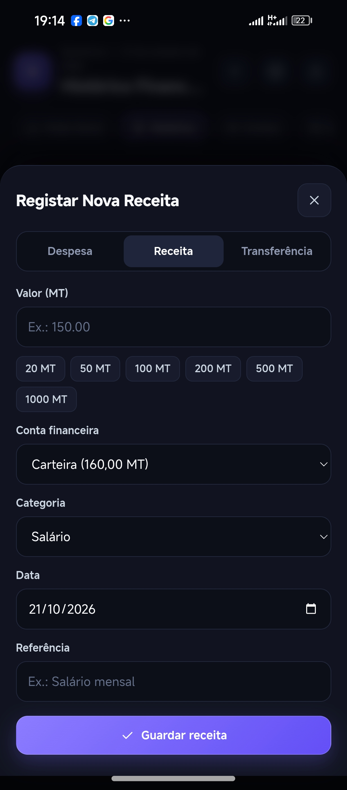

[Abrir imagem original](11-nova-receita.jpg)

## 12. Transferência entre contas

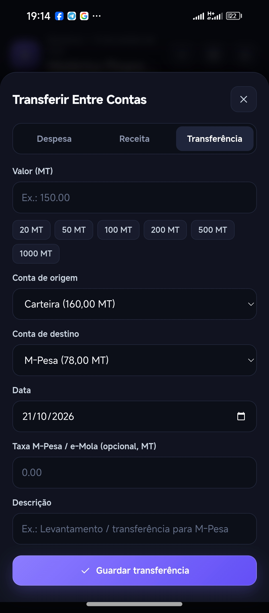

[Abrir imagem original](12-transferencia.jpg)

## 13. Contas financeiras

[Abrir imagem original](13-contas.jpg)

## 14. Banco e poupança

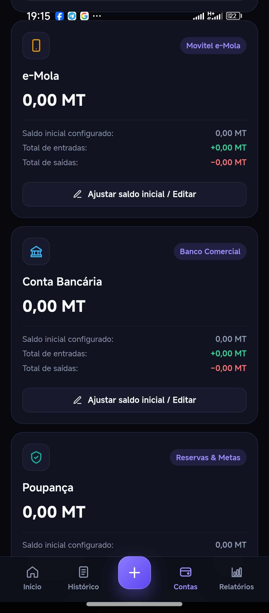

[Abrir imagem original](14-contas-banco-poupanca.jpg)

## 15. Relatório mensal

[Abrir imagem original](15-relatorios.jpg)

## 16. Relatório por categoria

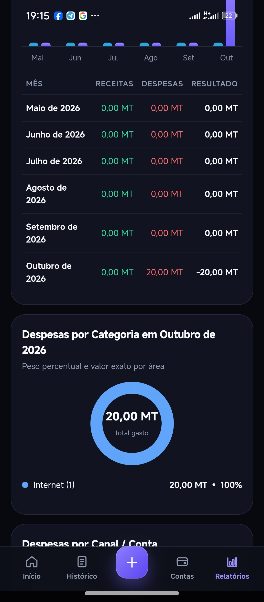

[Abrir imagem original](16-relatorios-categorias.jpg)

## 17. Definições do cofre

[Abrir imagem original](17-definicoes.jpg)

## 18. Backup e módulos

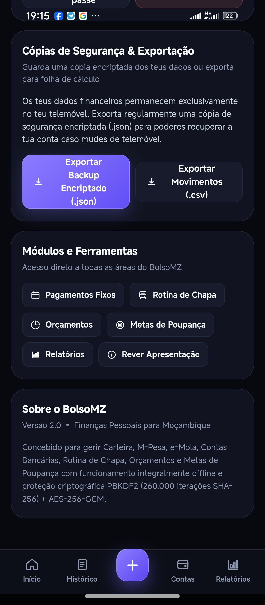

[Abrir imagem original](18-backup-e-modulos.jpg)
